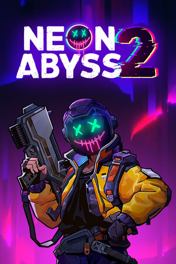

# NEON ABYSS 2 TRAINER
一个基于 Python + Tkinter 开发的《霓虹深渊2》现代化修改器，包含游戏内实时内存修改与本地存档深度编辑功能。

## ✨ 核心功能
- 🛡️ **内存级修改**：无敌、无限生命、秒杀、无限资源等实时功能（基于 IL2CPP 符号驱动，非硬编码）。
- 💾 **存档深度编辑**：XXTEA 解密，修改保险库资源、霓虹币、进化点数（自动备份，防损坏）。
- 🎨 **极简暗黑 UI**：无边框设计，平滑滚动，纯 Canvas 绘制圆角控件，悬浮提示。
## 🛠️ 技术栈
- Python 3.11
- Tkinter (UI)
- ctypes / Windows API (ReadProcessMemory / WriteProcessMemory)
- IL2CPP 符号驱动内存定位
- XXTEA + Gzip (存档解密)
## 🚀 如何使用
1. 去 **Releases** 页面下载最新的 `NeonAbyss2Trainer.exe`。
2. 启动游戏，进入对局。
3. 运行修改器，点击"附加游戏进程"。
## ⚠️ 免责声明
本项目仅供学习交流使用。修改器仅限单机模式使用，请勿在联机模式下使用。因使用本工具导致的任何账号封禁或存档损坏，作者概不负责。
